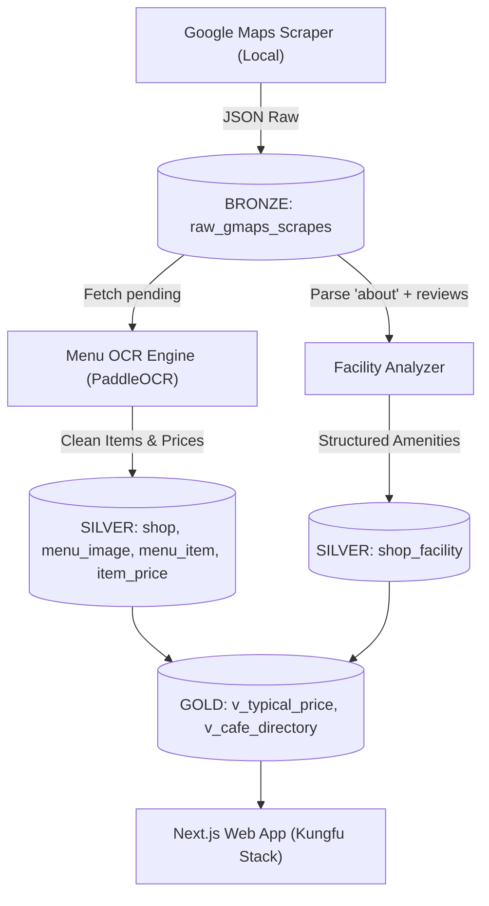

# ☕ Coffee Analysis - An Thượng (Đà Nẵng)

> **File ngữ cảnh chung (Root Context) dành cho toàn bộ AI Agents khi làm việc trong dự án.**
> Bất kỳ Agent nào tham gia vào dự án này bắt buộc phải đọc và tuân thủ các quy tắc, schema, và ranh giới kỹ thuật dưới đây.

---

## 1. Tổng quan Dự án & Triết lý Thiết kế

### 1.1. Mục tiêu
Xây dựng một hệ thống hoàn chỉnh từ dữ liệu đến ứng dụng cho thị trường quán cafe tại khu phố Tây **An Thượng** (Phường Mỹ An, Ngũ Hành Sơn, Đà Nẵng):
1. **Thu thập dữ liệu (Ingestion)**: Cào dữ liệu Google Maps vét cạn khu vực An Thượng (địa điểm, ảnh thực đơn, tiện ích `about`, đánh giá chi tiết `detailed_reviews`).
2. **Trích xuất thực đơn (Menu OCR)**: Chạy OCR xử lý ảnh menu, bóc tách giá tiền, quy đổi tên món chuẩn (Canonical items) và kiểm soát chất lượng (QC).
3. **Phân tích cơ sở vật chất (Facilities & Vibe)**: Khai thác tiện ích làm việc (Wi-Fi, ổ cắm, điều hòa), không gian và phong cách quán từ dữ liệu có sẵn.
4. **Lưu trữ phân tầng (Medallion Light)**: Tổ chức dữ liệu trên PostgreSQL / Supabase theo mô hình Bronze (Raw) $\rightarrow$ Silver (Processed) $\rightarrow$ Gold (Mart / Views).
5. **Giao diện người dùng (Web Application)**: Tra cứu quán cafe, lọc theo tiện ích (làm việc, máy lạnh, pet-friendly) và xem giá đồ uống điển hình, xây dựng trên nền tảng `kungfu-stack` (Next.js 16).

### 1.2. Triết lý Thiết kế Cốt lõi (BẮT BUỘC TUÂN THỦ)
- **Lean & Zero-Overhead**: Tuyệt đối không cài cắm các thư viện / framework nặng nề không cần thiết (không Airflow, không Celery, không các model Vision ngốn GPU như SigLIP/CLIP nếu không bắt buộc).
- **Offline-First & Low-Cost**: Tận dụng tối đa bộ quy tắc rule-based / regex thông minh và PaddleOCR cục bộ. Chỉ dùng API ngoài (như Gemini Flash) làm fallback khi thực sự cần.
- **Không xáo trộn mã nguồn lõi**: Kế thừa và bảo toàn 95% logic đã được kiểm chứng trong `menu_core.py` (CLAHE, deskew, `group_rows`, regex giá, rapidfuzz canonical matching).
- **Idempotency (Bất biến lặp lại)**: Mọi thao tác ghi database phải chạy lại được nhiều lần mà không sinh rác, không tạo duplicate, và không crash pipeline khi gặp dữ liệu đã tồn tại.

---

## 2. Cấu trúc Dự án (Monorepo Layout)

```
coffee_analysis/
├── AGENTS.md                  # 📌 FILE NÀY: Master context toàn bộ dự án
├── README.md                  # Tài liệu giới thiệu dự án
├── .gitignore                 # Bỏ qua node_modules, cache Python, file env
│
├── pipeline/                  # 🐍 Module Thu thập & Xử lý Dữ liệu (Python)
│   ├── AGENTS.md              # Context chi tiết cho Pipeline Agents
│   ├── colab_reference/       # Code trích xuất gốc từ Colab để đối chiếu
│   │   ├── menu_core.py       # Logic xử lý tọa độ, regex giá, canonical matching
│   │   ├── menu_db.py         # Hàm kết nối & thao tác DB cũ
│   │   └── schema.sql         # Schema Postgres ban đầu
│   ├── scraper/               # Cấu hình & wrapper chạy omkarcloud/google-maps-scraper
│   ├── ocr/                   # Module PaddleEngine & Menu extractor
│   ├── facilities/            # Module bóc tách tiện ích (Gmaps about + Review NLP)
│   ├── db/                    # Supabase client, migrations, upsert logic
│   └── run_pipeline.py        # Runner điều phối tự động
│
└── web/                       # 🥋 Ứng dụng Web (Next.js 16 - Kungfu Stack)
    ├── AGENTS.md              # Context & quy ước Next.js cho Web Agents
    ├── DESIGN.md              # Design system & token YAML
    ├── src/
    │   ├── app/               # App router (page, layout)
    │   ├── features/          # Nghiệp vụ (danh sách quán, bộ lọc, chi tiết menu)
    │   ├── components/        # UI shadcn/ui
    │   └── server/db/         # Kết nối Supabase query views Tầng Gold
    └── package.json
```

---

## 3. Kiến trúc Dữ liệu Phân tầng (Supabase Medallion)

Tất cả bảng đều nằm trên Supabase PostgreSQL, liên kết nhất quán qua khóa chính `place_id` (Google Maps Place ID).



### 3.1. Tầng 1: BRONZE (`raw_gmaps_scrapes`)
- **Mục đích**: Lưu trữ 100% nguyên trạng payload từ `omkarcloud/google-maps-scraper` dưới dạng JSONB.
- **Đặc tính**: Không bao giờ xóa hoặc sửa dữ liệu gốc. Cho phép replay toàn bộ pipeline khi cập nhật logic bóc tách mà không cần cào lại Google Maps.
- **Trạng thái (`status`)**:
  - `pending`: Vừa cào về, chờ xử lý.
  - `processing`: Đang được worker nhận xử lý.
  - `completed`: Đã xử lý xong toàn bộ (menu OCR + facility).
  - `failed`: Lỗi trong quá trình xử lý (lưu kèm `error_message`).

### 3.2. Tầng 2: SILVER (Bảng Chuẩn hóa & Thực thể Nghiệp vụ)
Kế thừa cấu trúc từ notebook gốc, tinh chỉnh chuẩn PostgreSQL:
1. **`shop`**: Thông tin định danh quán (`place_id`, `name`, `address`, `lat`, `lng`, `rating`, `reviews`, `price_range`, `phone`, `website`, `maps_link`).
   - *Cơ chế ghi*: `ON CONFLICT (place_id) DO UPDATE` để luôn cập nhật rating/reviews mới nhất.
2. **`menu_image`**: Quản lý từng ảnh menu hoặc ảnh quán (`image_id`, `place_id`, `url`, `url_sha1`, `label`, `is_menu`, `status`, `n_boxes`, `n_items`).
3. **`canonical_item` & `canonical_alias`**: Danh mục đồ uống chuẩn hóa (`ca_phe_den`, `ca_phe_sua`, `bac_xiu`, `cold_brew`, `matcha_latte`, v.v.) và các biến thể tên gọi.
4. **`menu_item`**: Từng món bóc tách từ ảnh OCR (`item_id`, `image_id`, `place_id`, `name_raw`, `name_norm`, `canonical_id`, `match_score`, `ocr_conf`, `bbox`, `needs_review`).
5. **`item_price`**: Giá tiền của từng món (`price_id`, `item_id`, `variant`, `amount`, `currency`, `inferred_k`, `plus_plus`).
6. **`shop_facility`**: Thông tin tiện ích và cơ sở vật chất (Work-friendly, Wi-Fi, ổ điện, máy lạnh, đỗ xe, thanh toán).

### 3.3. Tầng 3: GOLD (Views & Analytics)
- **`v_typical_price`**: View tổng hợp mức giá tối thiểu, tối đa của từng món chuẩn hóa theo từng quán (đã có từ Colab).
- **`v_cafe_directory`**: View phẳng phục vụ trực tiếp cho Web Frontend: Gộp thông tin quán + khoảng giá trung bình + điểm làm việc (work-friendly) + các tags tiện ích (máy lạnh, wifi, ổ cắm).

---

## 4. Đặc tả Hợp đồng Dữ liệu (Data Contracts)

### 4.1. Cấu trúc Đầu ra từ Omkar Scraper
File cào xuất ra danh sách object JSON chứa các trường chính:
```json
{
  "place_id": "ChIJ...",
  "title": "43 Factory Coffee Roaster",
  "link": "https://www.google.com/maps/place/...",
  "main_category": "Coffee shop",
  "categories": ["Coffee shop", "Espresso bar"],
  "rating": 4.6,
  "reviews": 1250,
  "address": "422 Ngô Thì Sĩ, Mỹ An, Ngũ Hành Sơn, Đà Nẵng",
  "coordinates": {"latitude": 16.0512, "longitude": 108.2435},
  "price": "$$",
  "phone": "+84 90 5...",
  "website": "https://...",
  "images": [
    {"about": "Menu", "link": "https://lh5.googleusercontent.com/p/..."},
    {"about": "Interior", "link": "https://lh5.googleusercontent.com/p/..."}
  ],
  "about": [
    {
      "id": "service_options",
      "name": "Service options",
      "options": [{"name": "Takeout", "enabled": true}, {"name": "Dine-in", "enabled": true}]
    },
    {
      "id": "amenities",
      "name": "Amenities",
      "options": [{"name": "Wi-Fi", "enabled": true}, {"name": "Restroom", "enabled": true}]
    }
  ],
  "detailed_reviews": [
    {
      "author_title": "John Doe",
      "rating": 5,
      "text": "Quán không gian đẹp, máy lạnh mát rượi, wifi mạnh rất hợp ngồi làm việc laptop...",
      "published_at": "2 months ago"
    }
  ]
}
```

### 4.2. Quy tắc Ánh xạ Sang Menu OCR (`menu_image` & `extract_items`)
- **Lấy ảnh**: Quét trường `images`. Ưu tiên ảnh có `about` khớp regex `menu|thực đơn|thuc don|price|bảng giá`.
- **Đơn vị tiền tệ (PRICE_RE)**:
  - Nếu menu ghi `35`, `45` (số trần 2-3 chữ số) mà không có chữ 'đ'/'VND', suy luận là $\times 1000$ (inferred_k).
  - Tự động bỏ qua các số gắn đơn vị định lượng: `ml`, `oz`, `gr`, `g`, `%`, `cal`, `kcal`.
- **Từ điển Món khu An Thượng**: Cần bổ sung vào `extra_aliases.json` các món đặc trưng khu phố Tây:
  - Specialty Coffee: `flat_white`, `cortado`, `piccolo`, `cold_brew`, `affogato`, `dirty_coffee`.
  - Healthy / Tea: `kombucha`, `matcha_latte`, `smoothie_bowl`, `chai_latte`.

### 4.3. Quy tắc Trích xuất Cơ sở vật chất (`shop_facility`)
1. **Từ trường `about` (100% tin cậy)**:
   - `amenities` có `Wi-Fi` / `Free Wi-Fi` $\rightarrow$ `has_wifi = true`.
   - `service_options` có `Outdoor seating` $\rightarrow$ `seating_types += "outdoor"`.
   - `payments` có `Credit cards` / `NFC mobile payments` $\rightarrow$ `payment_methods += ["card", "nfc"]`.
2. **Từ trường `detailed_reviews` (Regex NLP)**:
   - Điều hòa: Khớp `máy lạnh|điều hòa|mát mẻ` $\rightarrow$ `has_ac = true`. Khớp `nóng|quạt|hầm|bí` $\rightarrow$ giảm điểm tin cậy.
   - Ổ cắm điện: Khớp `ổ cắm|ổ điện|chỗ sạc|cắm laptop` $\rightarrow$ `power_outlets = 'plenty'` hoặc `'few'`.
   - Yên tĩnh / Làm việc: Khớp `yên tĩnh|học bài|làm việc|laptop|work` $\rightarrow$ tăng `work_friendly_score`.

---

## 5. Quy ước Vận hành & Phân chia Trách nhiệm Agent

### 5.1. Khi Agent làm việc trên `pipeline/` (Data Engineering)
- **Môi trường**: Python 3.10+, PostgreSQL client (`psycopg` v3 hoặc `asyncpg`), `paddleocr`, `opencv-python-headless`.
- **Nguyên tắc chống tắc nghẽn (Anti-Crash)**:
  - Tuyệt đối KHÔNG `raise ValueError` khi trùng dữ liệu. Dùng `ON CONFLICT DO NOTHING` hoặc `ON CONFLICT DO UPDATE`.
  - Batching: Xử lý theo từng quán độc lập; lỗi của 1 quán không được làm dừng toàn bộ tiến trình của các quán khác.
  - Tải ảnh song song: Sử dụng `ThreadPoolExecutor` để prefetch ảnh nhằm giảm độ trễ I/O mạng.
  - Lưu cache OCR: Ghi toạ độ `raw_boxes` trực tiếp vào DB để không bao giờ phải OCR lại ảnh cũ khi chỉ cần tinh chỉnh thuật toán ghép chữ.

### 5.2. Khi Agent làm việc trên `web/` (Frontend & Presentation)
- **Môi trường**: Next.js 16, React 19, TypeScript strict, Tailwind CSS v4, shadcn/ui.
- **Ranh giới**:
  - Tuân thủ nghiêm ngặt [web/AGENTS.md](file:///d:/UNIVERSITY/coffee_analysis/web/AGENTS.md) và [web/DESIGN.md](file:///d:/UNIVERSITY/coffee_analysis/web/DESIGN.md).
  - Chỉ đọc dữ liệu từ các Views tầng Gold hoặc bảng Silver thông qua Server Actions / Data Access Layer trong `src/server/db/`.
  - Không viết code ghi trực tiếp vào các bảng OCR thô từ frontend.

---

## 6. Tiêu chí Hoàn thành (Definition of Done)

Một tính năng hoặc module được coi là hoàn thành khi:
1. **Pipeline**:
   - Dữ liệu cào từ Google Maps được đưa vào Supabase mà không bị sót trường quan trọng.
   - Quá trình chạy thử với batch 10 quán An Thượng vượt qua cả 3 giai đoạn: Bronze (Raw) $\rightarrow$ OCR & Facility $\rightarrow$ Silver/Gold Views.
   - Không còn lỗi `UniqueViolation` khi chạy lại lần thứ 2 với cùng danh sách quán.
2. **Web**:
   - Lệnh `pnpm check` và `pnpm build` trong thư mục `web/` chạy sạch lỗi (0 errors, 0 warnings nghiêm trọng).
   - Hiển thị danh sách quán, lọc được tiện ích (Wifi, máy lạnh, ổ cắm) và xem được bảng giá menu tối thiểu/tối đa.
3. **Tài liệu**:
   - Cập nhật tài liệu tương ứng tại `pipeline/AGENTS.md` hoặc `web/AGENTS.md` nếu có thay đổi về quy ước cấu trúc hoặc trường dữ liệu.
