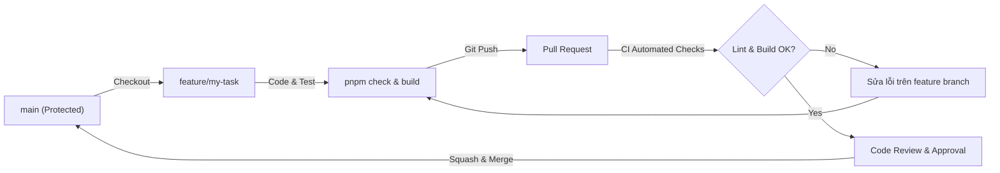

# 📘 Hướng Dẫn Quy Ước Làm Việc & Đóng Góp (Contribution Guidelines)

> **QUY TẮC BẮT BUỘC ĐỐI VỚI TẤT CẢ LẬP TRÌNH VIÊN VÀ AI AGENTS THAM GIA DỰ ÁN.**

---

## 1. 🛡️ Chính Sách Bảo Vệ Nhánh Chính (`main`)

Để đảm bảo tính toàn vẹn của hệ thống, branch `main` được bảo vệ nghiêm ngặt:

1. **CHẶN PUSH TRỰC TIẾP**: Tuyệt đối không thực hiện lệnh `git push origin main`.
2. **CHẶN MERGE TRỰC TIẾP KHÔNG QUA REVIEW**: Mọi thay đổi code bắt buộc phải đi qua **Pull Request (PR)**.
3. **CHẶN MERGE KHI TEST LỖI**: PR chỉ được phép merge khi toàn bộ các bước kiểm tra (Typecheck, Lint, Build) đều đạt kết quả 100% xanh.

### Hướng dẫn thiết lập trên GitHub Repository (Dành cho Maintainer)
Vào **Settings** > **Branches** > Thêm Rule cho `main`:
- [x] **Require a pull request before merging**
  - [x] Require approvals (ít nhất 1 reviewer hoặc chủ dự án duyệt).
  - [x] Dismiss stale pull request approvals when new commits are pushed.
- [x] **Require status checks to pass before merging**
  - [x] Require branches to be up to date before merging.
  - [x] Chọn status check từ GitHub Actions CI (`web-ci`).
- [x] **Do not allow bypassing the above settings** (Áp dụng cho tất cả thành viên, kể cả Administrators).

---

## 2. 🌿 Quy Chuẩn Đặt Tên Nhánh (Git Branching Model)

Mỗi nhánh phải bắt đầu từ `main` mới nhất và tuân theo tiền tố ngữ nghĩa:

| Loại nhánh | Tiền tố | Ví dụ |
| :--- | :--- | :--- |
| **Tính năng mới** | `feature/` hoặc `feat/` | `feature/map-view-traffic`, `feat/export-csv` |
| **Sửa lỗi** | `fix/` | `fix/select-dropdown-cutoff`, `fix/db-timeout` |
| **Tối ưu hiệu năng** | `perf/` | `perf/query-memoization` |
| **Tái cấu trúc mã nguồn** | `refactor/` | `refactor/analytics-dal` |
| **Tài liệu** | `docs/` | `docs/update-pipeline-readme` |

---

## 3. 💬 Quy Chuẩn Commit (Conventional Commits)

Format commit message bắt buộc:
```
<type>(<scope>): <mô tả ngắn gọn bằng tiếng Anh hoặc tiếng Việt rõ nghĩa>
```

- **Type**: `feat`, `fix`, `docs`, `style`, `refactor`, `perf`, `test`, `chore`.
- **Scope**: `map`, `analytics`, `cafes`, `cafe-detail`, `pipeline`, `db`, `ui`.
- **Ví dụ**:
  - `feat(map): add 24h foot-traffic chart modal`
  - `fix(ui): prevent day tabs text wrapping on mobile`
  - `refactor(analytics): separate business insights logic`

---

## 4. 🔍 Tiêu Chuẩn Chất Lượng Trước Khi Mở PR (Definition of Done)

Trước khi mở PR hoặc đẩy code lên remote, lập trình viên / Agent **BẮT BUỘC** phải chạy các lệnh kiểm tra sau tại thư mục liên quan:

### 4.1. Đối với thư mục `web/`:
```bash
cd web

# 1. Định dạng code
pnpm exec prettier --write src

# 2. Kiểm tra lỗi cú pháp và quy chuẩn
pnpm lint

# 3. Kiểm tra kiểu dữ liệu TypeScript nghiêm ngặt (Zero error)
pnpm typecheck

# 4. Kiểm tra build sản phẩm (Next.js production build)
pnpm build
```
> [!IMPORTANT]
> Nếu bất kỳ lệnh nào trong 4 lệnh trên báo lỗi (exit code $\neq 0$), lập trình viên phải sửa triệt để trước khi tạo PR.

### 4.2. Đối với thư mục `pipeline/`:
- Dữ liệu thêm/sửa phải có cơ chế **Idempotency** (Bất biến lặp lại): không sinh lỗi trùng lặp khi chạy lại pipeline.
- Không sửa schema database trực tiếp mà không có file migration trong `pipeline/db/migrations/`.

---

## 5. 🚀 Quy Trình Tạo & Merge Pull Request



1. **Mở PR**: Điền đầy đủ mục đích, phạm vi thay đổi và hình ảnh minh họa (nếu có thay đổi UI) theo PR template.
2. **Review**: Tối thiểu 1 thành viên kiểm tra logic và ranh giới hệ thống.
3. **Merge**: Sử dụng hình thức **Squash and merge** để giữ lịch sử commit trên nhánh `main` luôn gọn gàng và dễ theo dõi.
